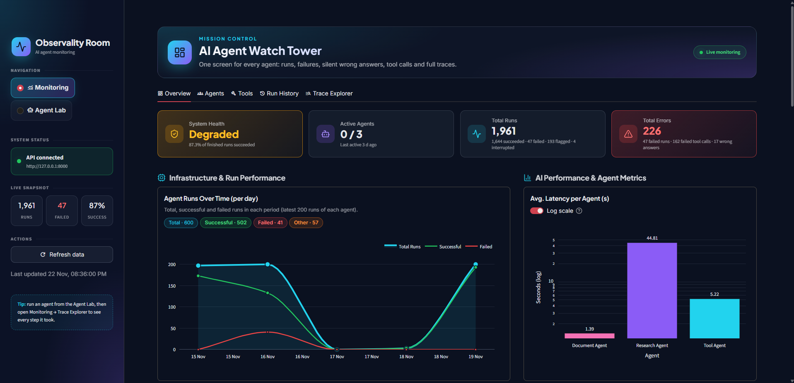
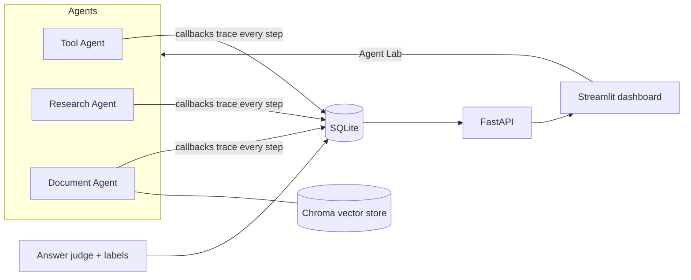
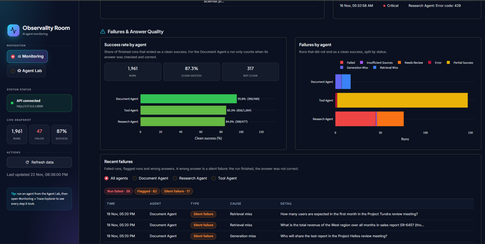
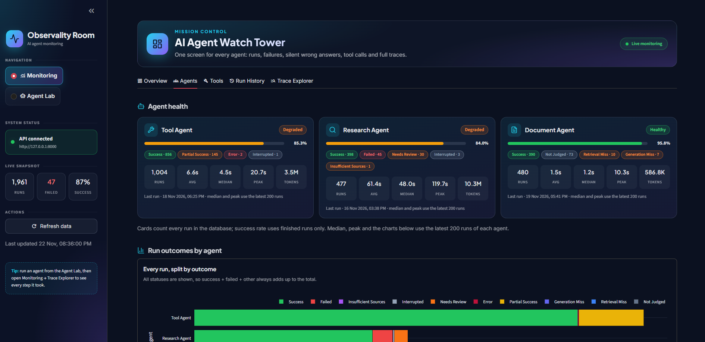
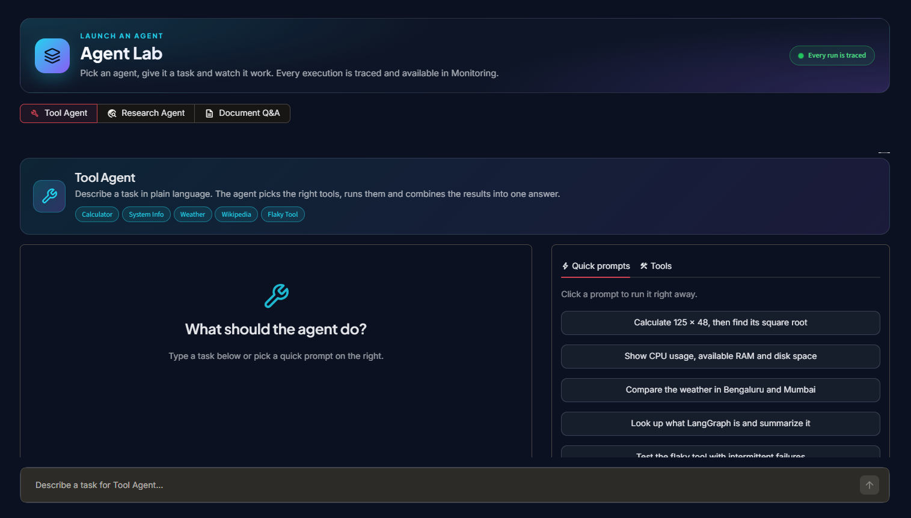
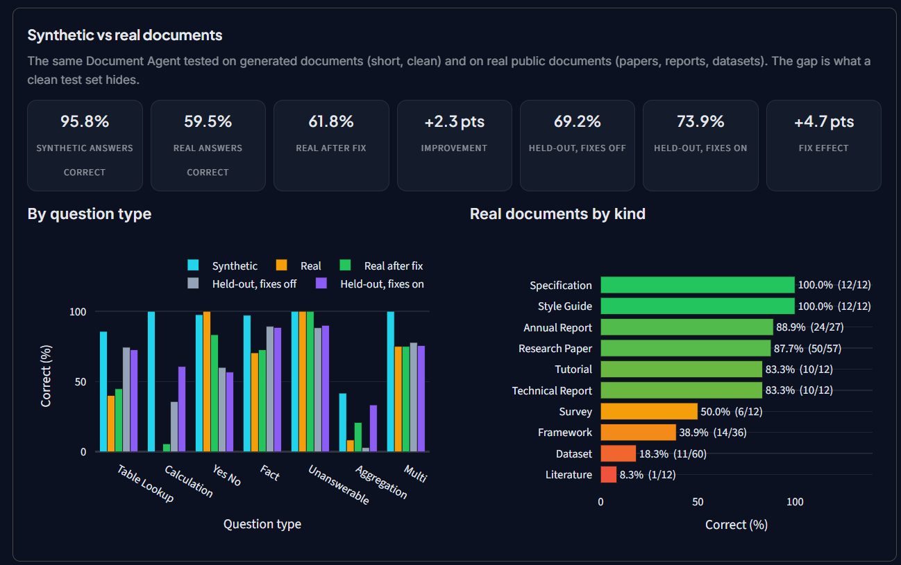

<div align="center">



**Run status says "success". Is the answer actually right? This project checks both, across three different AI agents.**

<br/>

<table>
<tr>
<td align="center"><h2>3,975</h2>traced runs</td>
<td align="center"><h2>17M</h2>tokens recorded</td>
<td align="center"><h2>95.8% → 59.5%</h2>generated vs real documents</td>
<td align="center"><h2>69.2% → 73.9%</h2>held-out, fixes off vs on</td>
</tr>
</table>

<br/>


<br/>


<br/><br/>



</div>

---

## ▍ The idea

A normal monitor only knows when a run **crashes**. An AI agent can also fail **without crashing**:
it retrieves the wrong chunk, a tool returns bad data, or the model answers confidently and wrongly.
The run says `success`, the answer is wrong. This project calls that a **silent failure**.

AI Agent Watch Tower runs three different agents, records every step of every run,
checks answers against known correct answers, and shows both kinds of failure in one place.
The next phase trains ML models on this run data to predict failures.


### At a glance

| | |
|---|---|
| **Agents monitored** | Tool Agent, Research Agent, Document/RAG Agent |
| **Data** | 3,975 traced runs, about 17 million tokens, every step stored in SQLite |
| **Clean-run success** | Tool 85.3% · Research 83.4% · Document 99.5% |
| **Silent-failure gap** | Document Agent: 95.8% correct on generated documents, 59.5% on real ones |
| **Retrieval fixes (held-out, same questions)** | 69.2% without fixes, 73.9% with fixes (CSV 29.6% to 49.1%) |

---

## ▍ Where the project stands

| Phase | What | Status |
|---|---|---|
| 1 | Three agents, full tracing, FastAPI, dashboard, data collection | Done |
| 1 | Answer-quality checks and failure labels (Document Agent) | Done |
| 2 | Real public documents for the Document Agent (20 files, 252 runs) and a first retrieval fix | Done |
| 3 | **ML**: predict failures and latency from run data | Planned |
| 4 | **Deep learning**: failure / anomaly classifier (PyTorch) | Planned |
| 5 | **GenAI**: LLM explanations of failures, RAG over traces and logs | Planned |
| 6 | **Agentic AI**: LangGraph investigator agent with human approval | Planned |
| 7 | Docker and deployment | Planned |

---

## ▍ How it works



---

## ▍ The three agents

| Agent | What it does |
|---|---|
| **Tool Agent** | Chooses and calls tools (calculator, weather, Wikipedia, system info, a deliberately flaky tool) in a function-calling loop |
| **Research Agent** | Plans queries, searches the web (Tavily), crawls pages, analyses sources, writes a cited report, then a critic checks the claims |
| **Document Agent** | RAG over PDF, DOCX, TXT and CSV files: chunking, NVIDIA embeddings, Chroma, top-4 retrieval |

---

## ▍ What the dashboard shows

- Health and success rate per agent, runs over time, latency, tokens
- Every status in its own colour (success, failed, needs review, retrieval miss, generation miss ...)
- **Failures of every agent**: failed runs, flagged runs and silent failures (wrong answers)
- **Synthetic vs real documents**: the same agent on generated documents, real documents (before and after the fixes) and held-out questions, side by side
- Run history with filters, and a **trace explorer** that opens every step of one run
- **Agent Lab**: run any agent from the dashboard, then open its trace

---

## ▍ Key findings: generated documents

The first test: 95.8% correct, with every wrong answer hiding behind a `success` status.

<details>
<summary><b>Generated documents: full results (407 questions, 44 documents)</b></summary>

407 questions with known answers over 44 generated documents (14 document types, 4 file formats).
Every answer is checked against the known answer, so a run with status `success` can still be marked wrong.

**390 of 407 answers correct (95.8%).** What the data shows:

- **Silent failures are real.** All 17 wrong answers came from runs that finished as `success`. A monitor that only watches run status would show this agent as 100% healthy.
- **Aggregation is the weak spot:** 5 of 12 correct (41.7%). Sums and counts need many rows, but retrieval returns only the top 4 chunks.
- **File format matters.** PDF and DOCX answers were 100% correct, TXT 91.6%, CSV 72.2%. Every wrong answer came from a CSV or TXT file. The Sales Report type was worst (53.3%).
- **More retrieval problems than model problems.** Of the 17 wrong answers, 10 were retrieval misses (the retrieved chunks did not contain the answer) and 7 were generation misses (the chunks had the answer, the model still got it wrong).
- **No hallucination on unanswerable questions:** 67 of 67 correctly refused when the document did not have the answer.
- **Question style barely matters.** Plain 95.0%, Hinglish 96.3%, Polite 97.6%.

| Question type | Correct |
|---|---|
| Aggregation | 5 / 12 (41.7%) |
| Table lookup | 18 / 21 (85.7%) |
| Fact | 210 / 216 (97.2%) |
| Yes / No | 40 / 41 (97.6%) |
| Calculation | 36 / 36 (100%) |
| Unanswerable | 67 / 67 (100%) |
| Multi-part | 14 / 14 (100%) |

**Data collected so far:** 3,975 traced runs and about 17 million tokens (1,004 Tool Agent runs, 477 Research Agent runs and 2,494 Document Agent runs).
Runs lost to API problems (rate limits, timeouts) are kept as data, not hidden.

### Limitations of this first test

- The documents are generated and short. The next section tests real ones.
- The answer judge is rule-based (keyword and number matching), not an LLM judge.
- Results are from one model and one retrieval setting (top-4 chunks).

</details>

---

## ▍ Key findings: real documents (59.5%, then 73.9%)

The generated documents are clean and short. To check that, the same Document Agent was run on **20 real public documents**:
research papers (Attention, BERT, GPT-4, Llama 2, RAG), annual reports (Infosys, NVIDIA), the NIST AI RMF Playbook and two AWS Well-Architected lenses,
an LLM survey, PEP 8 and PEP 484, the Flask quickstart, Tiny Shakespeare and five CSV datasets (Titanic, tips, penguins, car mpg, airline passengers).
There are **84 questions with known answers**, each asked in 3 styles (plain, polite, Hinglish) = **252 runs**.

| Test set | Answers correct |
|---|---|
| Generated documents | **95.8%** (390 / 407) |
| Real documents | **59.5%** (150 / 252) |

Across all 2,494 Document Agent runs, 99.5% finished with status `success`. The run status does not change between the two sets.
Only the answer check shows the difference, which is the point of this project.

**By question type (real documents):** Yes/No 100%, Unanswerable 100%, Multi-part 75.0%, Fact 70.4%, Table lookup 40.0%, Aggregation 8.3%, Calculation 0%.
**By format:** DOCX 100%, PDF 72.2%, TXT 63.9%, **CSV 18.3%**.
**By style:** Plain 60.7%, Hinglish 60.7%, Polite 57.1%. Language and wording again matter little.
**Source file named correctly:** 95.2%. The agent usually finds the right file; it fails on the right *passage*.

<details>
<summary><b>Why the real documents fail, and the first fix (84 questions, before and after)</b></summary>

### Why it fails

- **Table-of-contents chunks beat the real text.** For NIST (0 of 12 correct) a question like "What does GOVERN 1.6 require?" matched the contents page, which lists every heading. The agent answered "I cannot determine ...", an honest refusal that is still a wrong answer.
- **CSV questions cannot be answered from 4 rows.** A CSV is stored one row per chunk and only the top 4 chunks reach the model, so "How many passengers survived?" or "What is the average age?" cannot work (Titanic and penguins: 0 of 12).
- **Counting in plain text is impossible with retrieval.** "How many times does ROMEO: appear?" got "4" (the count in the 4 chunks) instead of 163. For "Which character speaks first?" the agent confidently said PETRUCHIO (right answer: First Citizen). That is a silent failure with no warning sign.
- **Hard questions fail most:** Easy 73.3%, Medium 66.7%, Hard 4.8%.

### First fix and result

Two changes to retrieval, no change to the model or the prompt:

1. Table-of-contents chunks are dropped (search 20 candidates, remove contents-like chunks, keep the best 4).
2. Each CSV gets one extra "dataset summary" chunk (row count, averages, counts per category), computed with pandas and retrieved like any other chunk.

The same 252 questions were run again and compared with the first run:

| Question type | Before | After |
|---|---|---|
| Calculation | 0.0% | 5.6% |
| Aggregation | 8.3% | 20.8% |
| Table lookup | 40.0% | 44.8% |
| Fact | 70.4% | 72.6% |
| Multi-part | 75.0% | 75.0% |
| Yes / No | 100% | 83.3% |
| Unanswerable | 100% | 100% |
| **All** | **59.5%** | **61.8%** |

Biggest gains: NIST 0% to 27%, Titanic 0% to 17%, penguins 0% to 25%, Aggregation 8% to 21%.
**An honest reading of this first test:** the overall gain is small (+2.3 points). 13 questions went from wrong to right, but 8 went from right to wrong
(for example Yes/No and car mpg got worse), and 249 of the 252 runs were judged in the second round. The model is not deterministic (temperature 0.3),
so part of that movement is run-to-run noise. The fix helped where it was aimed (NIST, CSV aggregation), but retrieval is not solved:
NIST is still at 27%, and counting questions need a different approach (for example running code on the whole file), not better chunks.

</details>

### Held-out check: 250 new questions, fixes on and off

The first 84 questions were used to find the problems, so they cannot prove that the fixes work in general.
So 250 **new** questions were written after the fixes (same 20 documents, different passages and rows), each asked in 3 styles = **750 runs**.
They were run twice: once with the fixes and once with a switch that turns them off (`AGENTOPS_NO_FIXES=1`), so the two runs differ in retrieval only.

| | Without fixes | With fixes |
|---|---|---|
| **All 750 runs** | **69.2%** | **73.9%** |
| CSV (216 runs) | 29.6% | 49.1% |
| PDF (390 runs) | 86.7% | 85.4% |
| TXT (108 runs) | 79.6% | 81.5% |
| DOCX (36 runs) | 86.1% | 75.0% |
| Aggregation | 2.9% | 33.3% |
| Calculation | 35.7% | 60.7% |
| Fact | 89.3% | 88.5% |
| Yes / No | 60.0% | 56.7% |

By dataset (without fixes to with fixes): Titanic 40.5% to 69.0%, car mpg 35.7% to 54.8%, tips 8.9% to 26.7%, penguins 6.7% to 33.3%, airline passengers 59.5% to 64.3%.

On the same questions, 50 went from wrong to right and 15 from right to wrong (net +35 runs, +4.7 points).

**What this shows**

- **The CSV summary chunk is the fix that works.** It lifts CSV answers by about 20 points and aggregation from 2.9% to 33.3%.
- **The table-of-contents filter shows no measurable gain here.** NIST went from 66.7% to 63.6%. The new NIST questions asked about specific sections, which the contents page did not outrank as often as in the first test.
- **Small drops on PDF and DOCX are probably noise,** not damage: the model is not deterministic and a DOCX has only 36 runs (4 questions fewer correct). The 15 right-to-wrong cases are the same kind of movement.
- **Still weak:** CSV at 49.1% (tips 26.7%, penguins 33.3%), Aggregation at 33.3% and Yes/No at 56.7%.

<details>
<summary><b>What is still broken, and limitations</b></summary>

### What is still broken

- **Retrieval searches all documents at once.** In wrong Yes/No answers a Flask question retrieved Titanic rows, and a car mpg question retrieved Llama 2 paper chunks. The agent then correctly said it could not answer, which still counts as wrong. Filtering retrieval by the document the question is about is the next fix.
- **Partial retrieval produces confident wrong answers.** Asked whether Juliet speaks a famous line, the agent said she does not, because the line was not in the 4 chunks it got. That is a silent failure with no warning sign.
- **Rows of a table cannot answer questions about the whole table** beyond what the one summary chunk contains (tips and penguins show this).

### Limitations

- The answer judge is rule-based (keyword and number matching), so a correct answer in different words can be marked wrong. Checked by hand for NIST, CSV and Shakespeare: those failures are real.
- Answers are checked against one expected phrase set per question. Page numbers in the question file are approximate and are not judged.
- 20 chunks were skipped during ingestion because the NVIDIA embedding API's content screening rejected them (logged in `data/real_skipped_chunks.csv`).
- One model, one chunk size (1000 / 150) and top-4 retrieval. No tuning was done beyond the two changes above.
- The held-out questions use the same 20 documents as the first set; they test new questions, not new documents. Each question was run once per setting, so differences of a few points are within run-to-run noise.

</details>

---

## ▍ Screenshots

<table>
<tr>
<td width="50%"><b>Failures and answer quality</b><br></td>
<td width="50%"><b>Agent health</b><br></td>
</tr>
<tr>
<td width="50%"><b>Trace explorer</b><br></td>
<td width="50%"><b>Run history</b><br></td>
</tr>
</table>

<table>
<tr>
<td width="50%"><b>Agent Lab</b><br></td>
<td width="50%"><b>Synthetic vs real documents</b><br></td>
</tr>
</table>

---

## ▍ Skills shown in this project

| Done | Planned |
|---|---|
| GenAI: prompting, function calling, NVIDIA NIM LLM | Machine learning: features, models, evaluation |
| RAG: loaders, chunking, embeddings, vector search | Deep learning with PyTorch |
| Agentic AI: tool use, multi-step research pipeline | GenAI over traces: explanations and RAG |
| LLM evaluation and observability, failure taxonomy | Agentic investigator with LangGraph |
| Backend: FastAPI, SQLAlchemy, SQLite | Docker and deployment |
| Dashboard: Streamlit and Plotly | |
| Data generation, labelling and a rule-based answer judge | |

---

## ▍ Stack

Python, LangChain, NVIDIA NIM (LLM and embeddings), Chroma, SQLite and SQLAlchemy,
FastAPI, Streamlit, Plotly, Tavily.

---

## ▍ Run it

```bash
pip install -r requirements.txt        # or: uv pip install -r requirements.txt
pip install -e .                       # makes the agentops package importable
cp .env.example .env                   # add NVIDIA_API_KEY and TAVILY_API_KEY

python scripts/init_db.py              # create the database
uvicorn agentops.api.main:app --port 8000
streamlit run dashboard/app.py         # in a second terminal
```

Generate the test documents, run the Document Agent over them and load the labels:

```bash
python scripts/make_documents.py
python scripts/run_document_bulk.py --limit 5
python scripts/import_labels.py
```

Real public documents (put the files in `data/real_documents/`, names as in `agentops/datagen/real_questions.py`):

```bash
python scripts/run_real_documents.py                 # first run ("before")
python scripts/reingest_csv.py                       # adds the CSV dataset-summary chunks
python scripts/run_real_documents.py --tag after     # same questions again ("after")
python scripts/run_real_documents.py --tag heldout   # 250 new questions x 3 styles (needs real_questions_2.py)
python scripts/import_labels.py
python scripts/summarize_real_documents.py           # accuracy tables and before / after
```

To run the same held-out questions with the fixes switched off (PowerShell shown; use `export` on Linux/macOS):

```powershell
$env:AGENTOPS_NO_FIXES="1"
python scripts/run_real_documents.py --tag heldout_nofix
Remove-Item Env:AGENTOPS_NO_FIXES
```

The `data/` folder (database, vector store, generated files) is not in the repo.
It is created when you run the scripts above.

---

## ▍ Project layout

```
agentops/agents      tool, research and document agents
agentops/monitoring  callbacks and recorder that trace every step
agentops/api         FastAPI routes
agentops/datagen     test questions, document generator, answer judge
agentops/db          database models
dashboard/           Streamlit app
scripts/             bulk runs, labels, summaries
docs/images/         screenshots
```

---

## ▍ Author

**Adarsh Singh** · [LinkedIn](https://www.linkedin.com/in/adarsh--ssingh/) · [GitHub](https://github.com/Adarsh-SSingh) · [Email](mailto:adarshsingh748263@gmail.com)

<br/>


