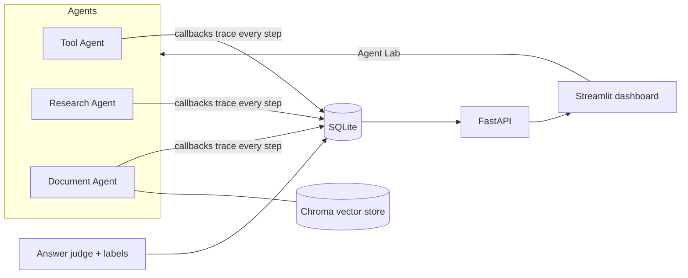
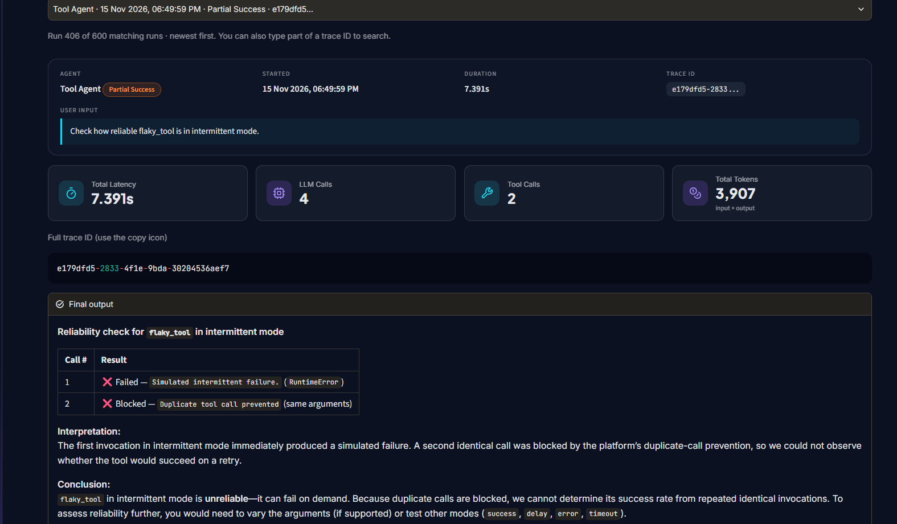
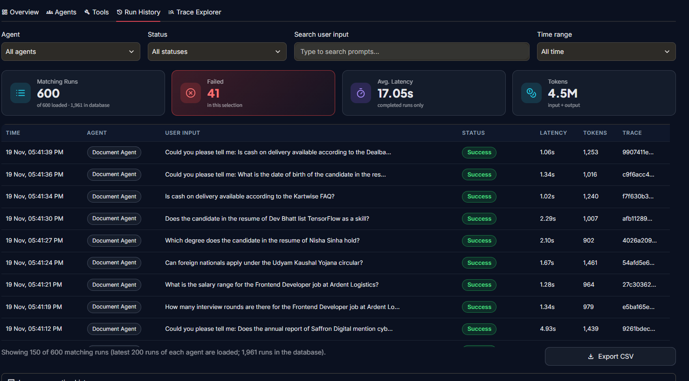

<div align="center">

# AI Agent Watch Tower

**Monitoring and observability for AI agents.**
Every run is traced and shown on one dashboard, and wrong answers that look like successes are caught.


</div>

## The idea

A normal monitor only knows when a run **crashes**. An AI agent can also fail **without crashing**:
it retrieves the wrong chunk, a tool returns bad data, or the model answers confidently and wrongly.
The run says `success`, the answer is wrong. This project calls that a **silent failure**.

AI Agent Watch Tower runs three different agents, records every step of every run,
checks answers against known correct answers, and shows both kinds of failure in one place.
The next phase trains ML models on this run data to predict failures.

## Where the project stands

| Phase | What | Status |
|---|---|---|
| 1 | Three agents, full tracing, FastAPI, dashboard, data collection | Done |
| 1 | Answer-quality checks and failure labels (Document Agent) | Done |
| 2 | Real public PDFs for the Document Agent | Planned |
| 3 | **ML**: predict failures and latency from run data | Planned |
| 4 | **Deep learning**: failure / anomaly classifier (PyTorch) | Planned |
| 5 | **GenAI**: LLM explanations of failures, RAG over traces and logs | Planned |
| 6 | **Agentic AI**: LangGraph investigator agent with human approval | Planned |
| 7 | Docker and deployment | Planned |

## How it works



## The three agents

| Agent | What it does |
|---|---|
| **Tool Agent** | Chooses and calls tools (calculator, weather, Wikipedia, system info, a deliberately flaky tool) in a function-calling loop |
| **Research Agent** | Plans queries, searches the web (Tavily), crawls pages, analyses sources, writes a cited report, then a critic checks the claims |
| **Document Agent** | RAG over PDF, DOCX, TXT and CSV files: chunking, NVIDIA embeddings, Chroma, top-4 retrieval |

## What the dashboard shows

- Health and success rate per agent, runs over time, latency, tokens
- Every status in its own colour (success, failed, needs review, retrieval miss, generation miss ...)
- **Failures of every agent**: failed runs, flagged runs and silent failures (wrong answers)
- Run history with filters, and a **trace explorer** that opens every step of one run
- **Agent Lab**: run any agent from the dashboard, then open its trace

## Answer quality and key findings (Document Agent)

407 questions with known answers over 44 generated documents (14 document types, 4 file formats).
Every answer is checked against the known answer, so a run with status `success` can still be marked wrong.

**390 of 407 answers correct (95.8%).** What the data shows:

- **Silent failures are real.** All 17 wrong answers came from runs that finished as `success`. A monitor that only watches run status would show this agent as 100% healthy.
- **Aggregation is the weak spot:** 5 of 12 correct (41.7%). Sums and counts need many rows, but retrieval returns only the top 4 chunks.
- **File format matters.** PDF and DOCX answers were 100% correct, TXT 91.6%, CSV 72.2%. Every wrong answer came from a CSV or TXT file. The Sales Report type was worst (53.3%).
- **More retrieval problems than model problems.** Of the 17 wrong answers, 10 were retrieval misses (the retrieved chunks did not contain the answer) and 7 were generation misses (the chunks had the answer, the model still got it wrong).
- **No hallucination on unanswerable questions:** 67 of 67 correctly refused when the document did not have the answer.
- **Question style barely matters.** Plain 95.0%, Hinglish 96.3%, Polite 97.6%.

| Question type | Correct |
|---|---|
| Aggregation | 5 / 12 (41.7%) |
| Table lookup | 18 / 21 (85.7%) |
| Fact | 210 / 216 (97.2%) |
| Yes / No | 40 / 41 (97.6%) |
| Calculation | 36 / 36 (100%) |
| Unanswerable | 67 / 67 (100%) |
| Multi-part | 14 / 14 (100%) |

**Data collected so far:** about 1,000 Tool Agent runs, 480 Research Agent runs and 480 Document Agent runs.
Runs lost to API problems (rate limits, timeouts) are kept as data, not hidden.

### Limitations

- The documents are generated, not real. Real public PDFs are the next test.
- The answer judge is rule-based (keyword and number matching), not an LLM judge.
- Results are from one model and one retrieval setting (top-4 chunks).

## Screenshots

<table>
<tr>
<td width="50%"><b>Failures and answer quality</b><br></td>
<td width="50%"><b>Agent health</b><br></td>
</tr>
<tr>
<td width="50%"><b>Trace explorer</b><br></td>
<td width="50%"><b>Run history</b><br></td>
</tr>
</table>

<b>Agent Lab</b><br>


## Skills shown in this project

| Done | Planned |
|---|---|
| GenAI: prompting, function calling, NVIDIA NIM LLM | Machine learning: features, models, evaluation |
| RAG: loaders, chunking, embeddings, vector search | Deep learning with PyTorch |
| Agentic AI: tool use, multi-step research pipeline | GenAI over traces: explanations and RAG |
| LLM evaluation and observability, failure taxonomy | Agentic investigator with LangGraph |
| Backend: FastAPI, SQLAlchemy, SQLite | Docker and deployment |
| Dashboard: Streamlit and Plotly | |
| Data generation, labelling and a rule-based answer judge | |

## Stack

Python, LangChain, NVIDIA NIM (LLM and embeddings), Chroma, SQLite and SQLAlchemy,
FastAPI, Streamlit, Plotly, Tavily.

## Run it

```bash
pip install -r requirements.txt        # or: uv pip install -r requirements.txt
pip install -e .                       # makes the agentops package importable
cp .env.example .env                   # add NVIDIA_API_KEY and TAVILY_API_KEY

python scripts/init_db.py              # create the database
uvicorn agentops.api.main:app --port 8000
streamlit run dashboard/app.py         # in a second terminal
```

Generate the test documents, run the Document Agent over them and load the labels:

```bash
python scripts/make_documents.py
python scripts/run_document_bulk.py --limit 5
python scripts/import_labels.py
```

The `data/` folder (database, vector store, generated files) is not in the repo.
It is created when you run the scripts above.

## Project layout

```
agentops/agents      tool, research and document agents
agentops/monitoring  callbacks and recorder that trace every step
agentops/api         FastAPI routes
agentops/datagen     test questions, document generator, answer judge
agentops/db          database models
dashboard/           Streamlit app
scripts/             bulk runs, labels, summaries
docs/images/         screenshots
```